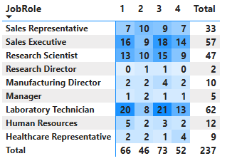

# HR Analytics Dashboard: The True Cost of Turnover

##  Project Overview
Losing good employees is expensive. I built this dashboard to prove a simple point: **fixing problems like low pay, poor satisfaction, and bad work environments is much cheaper than replacing people.** When turnover is high, companies lose money, make more mistakes, and destroy team loyalty.

## Tools Used
* **Power BI** Data cleaning, DAX modeling, and interactive dashboard design.
* **Excel** Used for reviewing, structuring, and preparing the raw HR dataset. 
* **Git & PowerShell** Repository setup and version control.
* **Markdown** Project documentation.

## The Problem: The Hidden Damage of Attrition
Ignoring why people leave triggers four major issues:
* ** Wasted Money:** Recruitment and training costs quickly drain company budgets.
* ** More Mistakes:** New hires face a steep learning curve, leading to more operational errors.
* ** Slower Work:** Short-staffed teams face bottlenecks, burnout, and delayed projects.
* ** Broken Loyalty:** Watching peers quit lowers morale and triggers a domino effect of resignations.

##  What the Data Shows

### 1. Pay & Job Satisfaction

* **Insight:** shows exact roles where low pay and poor satisfaction overlap, showing leadership who is at risk of quitting next.

### 2. Work Environment & Departments

* **Insight:** Shows that turnover isn't random, it clusters around specific departments, revealing localized management or cultural issues.

##  Summary & Key Insights
Attrition is a financial leak, not just an HR issue. The data proves that the biggest drivers of turnover, compensation mismatches and workplace stress are entirely within our control to fix before they damage bottom-line revenue.

##  Strategic Recommendations
1. **Adjust Competitive Pay:** Target salary fixes for the specific roles losing the most talent.
2. **Audit At-Risk Teams:** Run active check-ins with low-satisfaction departments to address cultural issues early.
3. **Streamline Onboarding:** Create clear training guides for new hires to reduce operational errors and speed up workflows.

